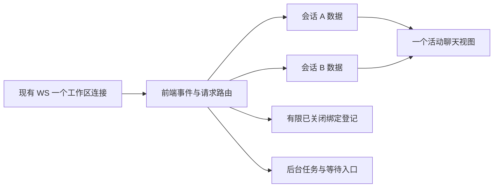

## Context

### 1. 最终范围与文档状态

2026-10-13 修订，方案 4，阶段 apply。风险 strict：客户端会话身份、请求并发和资源生命周期需专项验证，但不新增服务器协议。本设计只允许修改 **web/** 中的前端、测试、文档及必要的 Rust 生命周期适配。服务器代码、服务器配置、tui_gateway、hermes_cli、apps/shared、apps/desktop 和生成协议文件全部只读。客户端已实施并执行本地自动化/隔离界面验收；部署与原生桥仍待验证。

上一版依赖新增服务端方法的设计已被替代。不得把其要求留作“之后先改服务器”的实施前置。本版不新增 `session.snapshot`、`session.detach`、`attachment_id`、`session_multiplexing_version`、服务器游标屏障或受限快照参数。

工作区作用域为 origin + HERMES_BASE_PATH + profile；一版只服务一个选中的 profile，不跨后端或跨浏览器窗口共享 WS。Tauri 模式浏览器↔Rust桥↔远程服务器是一条逻辑通道，物理两段不算每页签连接。Rust 默认无须为本功能修改，它保持现有认证、路径、消息和关闭语义的透明转发。

### 2. 已有协议事实与实施门槛

仓库源码和现有共享类型证明下列方法形状；**不能据此假定远程服务器与本地仓库完全同版本**，最终接入必须验证目标部署。

| 事实 | 可读依据（相对仓库根） | 限制 |
|---|---|---|
| 可按运行 ID 分流事件与请求 | web/src/lib/web-chat-controller.ts::attach；apps/shared/src/json-rpc-channel.ts | 单会话操作状态也必须拆开，不能只去掉 own 条件 |
| resume 输入持久化 ID，activate 输入运行 ID | apps/shared/src/gateway-contract.generated.ts 的已有 SessionResume/Activate 类型 | 运行实例失效需要 resume，不能只 activate |
| 现有 transport 可以附着多个会话 | tui_gateway/session_transports.py；methods_session.py::session.activate | 目标部署实际 additive 附着语义必须验收 |
| 补发返回 seq/epoch/truncated/open_requests | 已有 SessionEventsSinceResult | replay 不等于附着，缓存不完整时不能仅补尾部 |
| 共享客户端已有 replay 可关闭的构造选项 | apps/shared/src/json-rpc-gateway.ts | 只在 web wrapper 传 replay=false；不修改共享包 |
| 普通恢复结果没有原子快照游标 | 已有 resume/activate/history 类型 | latest_seq 不能当作快照覆盖边界 |
| 没有公共的单会话取消绑定方法 | 已有服务器会话协议 | 关页签不等于服务器解绑；不能用 session.close 代替 |
| 回复 open_requests 先于 RPC promise resolve 交付 | apps/shared/src/json-rpc-channel.ts::handleFrame | 附着中的请求需要有限暂存和后续映射 |
| roster/tail 只检测 document 可见性 | web/src/hooks/useSubagentRoster.ts、useSubagentTail.ts | 增加活动会话可见条件，后台只收事件 |

## Goals / Non-Goals

**Goals:**

- 同一工作区一个逻辑活动 WS，多会话独立数据、草稿、操作和请求。
- 有效 warm 缓存切换不发 connect/resume/activate/history RPC，后台继续收消息和状态。
- 在已有协议允许的范围内有序补发；快照边界不明时采用保守替换，终态/空闲时再校准。
- 控制前端保留的历史、图片和缓冲，明确关闭后残留绑定及容量回收方式。
- 所有变更可仅通过 Web/Tauri 客户端更新交付，不要求服务器升级。

**Non-Goals:**

- 后端、共享包、桌面/TUI 产品及服务器配置修改；新 RPC/字段/模型工具。
- 原子快照的 exactly-once 保证、运行中冷恢复始终逐 token 直播、任意长历史的网络峰值上限。
- 立即取消一个会话的服务器订阅、按前端 LRU 释放远程 Agent、跨窗口单连接。
- 自动重发 prompt、自动回复审批、用关闭页签结束任务、持久化秘密/图片/完整历史。

## Decisions

### D1. 三层职责与连接生命周期

图内各数据容器属于 Web，服务器和 Rust 均不增加此路由。连接只在首次进入工作区、真实断线、明确安全回收、profile/来源变化或真正退出应用时改变；站内Files/Logs等路由切换不结束工作区；不能以 activeTabId 作为连接生命周期 effect 的依赖。

工作区拥有一个 GatewayClient、一套票据/鉴权、一套心跳/重连、一个会话列表刷新器。后台正文只更新对应数据；标题栏订阅摘要，不订阅每条 token。活动正文发布最多每帧一次；后台普通正文发布最多每 100ms 一次；终态、错误与请求立即发布。接收与 reducer 更新不能因 UI 节流丢事件。

### D2. 允许的模块边界

| 拟议模块（均在 web/ 内） | 职责 |
|---|---|
| src/lib/web-chat-workspace.ts | 工作区、连接、索引和活动视图 |
| src/lib/web-chat-workspace-events.ts | runtime 路由、请求和暂存 |
| src/lib/web-chat-workspace-recovery.ts | 唯一重连/replay/保守恢复调度 |
| src/lib/web-chat-session.ts | 独立会话状态与操作，提取现有 controller |
| src/lib/web-chat-session-events.ts | 消息/工具/子代理纯投影逻辑 |
| src/lib/web-chat-cache.ts | 历史、草稿、预览和资源预算 |
| src/lib/gatewayClient.ts | 现有 wrapper 转发 replay=false 选项 |
| src/contexts/WebChatWorkspaceProvider.tsx | 路由父级的懒初始化、profile生命周期及持续离开保护 |
| src/lib/web-chat-drafts.ts、web-chat-persistence.ts | 有限内存草稿/图片/视图状态与只含ID的刷新恢复 |
| src/hooks/useWebChat.ts、useWebChatTabs.ts | 薄工作区/页签订阅与动作 |
| src/pages/WebChatPage.tsx、ConversationTabs 和既有聊天组件 | 单视图、页签摘要及后台任务入口 |
| src/test、相关 Vitest | 真实现有 JSON-RPC channel 的可控远程协议 fixture |
| src-tauri（仅确有必要） | 现有关闭/离开保护接入与透明隧道验收；不是新的协议服务 |

不复制 apps/shared 的 JSON-RPC/WS 类，不增加共享包接口，不用 Rust 构造服务器不存在的快照游标或假解绑 ACK。测试服务端模拟器只在 web 测试环境内，不是产品代理或可部署后端。

### D3. 身份、代际和操作隔离

工作区维护 sessionKey = workspaceKey + storedSessionId、runtimeToSessionKey、tabs、activeTabId、trackedTasks、retainedBindings、pendingAttachments。另有 connectionGeneration、sessionGeneration、viewSelectionVersion 和实际已应用事件的 epoch/seq。没有服务器 attachment fencing token。

解析持久化身份按服务器已有 stored_session_id/session_key/resumed/info 字段；压缩 lineage 解析到同一 tip 时合并，不能重复打开。runtime ID 换代时旧回调和请求 responder 作废，不拼接不同 epoch 的正文。

每会话独立拥有 messages、assistant/tool 标识、busy/submitting、图片暂存与清理、command/model 状态、未确认发送、请求、草稿和视图状态。所有操作捕获发起时的 sessionKey、runtime、profile 和代际，返回只更新发起会话。切换显示不撤销 A 的图片上传/模型确认，也不能让结果写入 B。

发送确认、图片上传/撤销、命令或模型事务期间拒绝关闭/替换该目标；允许查看其他页签。批量请求的锁定状态与私密表单保持现有规则，秘密值不进入任何缓存。

### D4. 打开、选择和 warm 切换

1. 首次进入优先恢复已有scoped页签清单和活动项；不存在有效清单时兼容最近stored ID，再无记录则创建会话，维持既有sessionStorage范围和“未命名”标题。
2. 点击加号只打开选择面板并按需刷新历史列表；选中后才 create/resume 并附着，成功才提交新页签。
3. 已跟踪/登记且 runtime 有效的会话重新打开，优先复用成员关系与缓存；不重新创建运行实例。
4. 初始未绑定占位只在文本和图片均为空时复用；失败保持原活动会话和草稿。
5. 同目标打开合并请求，不同目标附着并发最多 2。迟到的成功不抢走用户之后的选择。
6. warm 切换只绑定活动 view、恢复草稿/光标/滚动/展开状态；不重连、不每次 activate，也不强制回到最新。
7. 冷缓存/不可信投影切换局部显示恢复状态，走 D6；其他会话连接和缓存不受影响。
8. 下拉替换不会删除旧服务器会话；将旧运行/等待对象转入跟踪，空闲对象进入登记，然后在同连接打开新目标。

create 的结果不确定时不自动再次 create、不按最近记录猜测 ID。标为连接存在未解析成员关系，禁用新附着；在 D8 允许的安全时机回收连接，或由用户退出工作区。已知会话继续使用，已知 prompt 绝不自动重发。

### D5. 后台事件、人机请求与已关闭对象

事件按 runtime 分发，无 session_id 的全局事件交给工作区。已支持但不显示的会话事件作为 no-op 推进真实已应用游标。创建/附着期间 unknown runtime 的事件/请求进入有界预绑定容器，身份返回后映射；不能写入活动会话。

服务器请求是独立 JSON-RPC 请求通道。按 epoch + runtime + request.id 去重；重放替换 responder，断线保留显示元数据但禁用回应，恢复后以 open_requests 对账。已知支持请求必须认领，不因其会话没有可见页签而返回 method-not-found；未知方法保持既有拒绝。

A 背景执行、C 等待审批时，B 的正文不更新，A/C 的摘要更新。用户可切回对应页签处理。已关闭但登记的 runtime 后来从其他窗口开始运行或发来请求时，自动晋升为可见后台任务/等待入口，不能静默丢请求或自动答复。

### D6. 现有协议下的恢复可靠性

有两种投影状态：

- **live-valid**：来自已知基线且持续有序应用的实时事件，保留 actualAppliedSeq 与完整连续投影。此游标只记录已真正 reduce 的事件。
- **refresh-required / snapshot-follow**：冷恢复、运行 ID 改变、epoch 改变、补发截断/缺号、缓存淘汰或不明快照边界。显示现有 resume/activate 的权威快照，**不能为它捏造一个覆盖序号**。

Web wrapper 向现有共享客户端构造器传 replay=false，工作区是唯一恢复 owner；自动和手动 replay 不能并行。只修改 wrapper，不修改 apps/shared。每次重连按活动、运行/等待、其他需要恢复对象排序，并发最多 2：

1. 同 epoch、原 runtime 有效、live-valid 缓存存在：activate(omit_messages=true) 重新附着；events.since(actualAppliedSeq) 并缓冲新到实时帧；检查 epoch/truncated/连续性，按 seq 去重应用一次。
2. 运行 ID 不存在（4007）或后端重启：按 stored ID resume，不使用失效 runtime activate；恢复结果作为替换快照，进入 refresh-required。
3. replay 截断、缺口、无有效 seq/epoch、历史缓存不存在：不把补发后缀加入不完整历史，改为现有 resume 或 activate 的完整返回状态。
4. 4009、请求拒绝、网络超时保留局部错误并可重试，不将恢复 A 的失败转换成整个工作区断线。

**运行中冷恢复的保守规则：** 对当前含 inflight 的未可信快照，不将同时抵达的 assistant delta/interim 直接拼进快照正文。实时事件仍更新 status、子代理、有限当前预览和请求；工具生命周期按调用ID独立投影，旧快照省略的显示侧工具结果按D14保留。当前可见会话最多每秒一个、无重叠的 activate(omit_messages=false) 刷新，用完整返回替换临时正文；后台不做这项全量轮询。明确显示“正在同步”，不能宣传此状态逐 token 无损直播。

收到 message.complete 以其完整最终正文替换对应临时回复，随后再取空闲的完整返回对账。终态可能先于 running=false 到达：最多 3 次有限延迟校准，仍在运行/再次开始任务则保留 snapshot-follow，不伪造 ready。稳定已有历史加上后续明确的新 message.start 可作为新的实时回合基线；如果有缓冲/边界不明，继续保守状态。

新创建并从空历史开始接收的会话可直接构建 live-valid；从普通快照恢复的会话不能仅因为“有一条最高 seq”就升级为 live-valid。原协议未提供事务快照 cursor，因此本版只承诺连续实时/完整缓存补发的去重、终态及稳定历史校准，**不承诺运行中冷快照与 delta 的 exactly-once 原子衔接**。

未知 prompt ACK 按原始提交上下文保留不确定提示，从 history/inflight 判断后由用户决定后续动作。任意历史同文不代表该次提交已接受，不自动重发或清空新草稿。

### D7. 关闭页签与后台跟踪

最后一个页签保留。关闭活动页签选择左侧邻居，无左侧则右侧；冷目标允许局部恢复。关闭的产品语义是移除视图，而非停止或解绑服务器会话。

| 目标状态 | 前端动作 |
|---|---|
| 空闲、无请求/无事务 | 立即移除页签和完整历史/媒体；保留本连接的轻量 retainedBindings 条目与有限草稿 |
| 运行或等待人机请求 | 移除页签及完整正文/预览，使正文投影失效；保留可达 trackedTasks、请求和成员关系，重开走现有完整恢复；不自动停止 |
| 客户端提交/图片/命令/模型事务进行中 | 拒绝关闭/替换这个目标，允许查看其他页签 |
| 真正离线且空闲 | 本地移除，并从下次恢复集合排除 |
| 已关闭 runtime 再出现运行/请求 | 晋升到 trackedTasks，给出重新打开/回应入口 |
| 背景任务完成且无请求 | 释放重历史和视图资源，回到轻量登记；服务器绑定仍可能存在 |

从本地 Map 删除不能取消远程成员关系。禁止普通关闭/替换/LRU 触发 session.close、session.delete 或 session.interrupt。即使已有 session.close 方法，它会影响运行实例和其他窗口，不能当成前端内存回收。

### D8. 有限登记与整连接安全回收

retainedBindings 是当前连接代际曾成功附着且仍可能存在的运行实例登记，包括可见页签、后台任务和已关闭空闲条目。本版最多 16 个，不能只数可见页签来规避限制；confirmed 4007 的旧运行实例可以移出，仍活着的成员不能伪装成已解绑。

容量还计入进行中create的预留槽和ACK未知create的保留槽，不能在身份尚未返回时并发突破上限。同目标复用不重复占槽；拒绝且确定未创建的操作才释放预留。

达到上限时优先复用已有登记目标，新的未附着会话暂不打开，界面解释“本次连接已关联较多会话”。提供明确的“回收空闲连接记录”按钮。只有所有已跟踪会话均不运行、无请求、无客户端事务、无未确认提交或未解析 create 结果时，允许一次整连接回收；未知 create 是可以通过排空旧连接解除的特例，但其他会话必须满足安全条件。

安全回收保留所需缓存/草稿，关闭旧 WS，丢弃已关闭空闲登记，以同一逻辑通道重连只恢复可见页签。不会调用 session.close；旧空闲运行实例随后是否回收由原服务器决定。禁止为了释放一个 slot 在 A 正在执行/等待回复时自动断开所有会话。存在忙对象时提示先处理任务；真实网络断线始终按 D6 恢复，不受此回收前置限制。

因此没有“单个页签一关，服务器订阅即释放”的保证，也不声称前端控制服务器内存；登记数上限和安全重连是只改客户端下的明确取舍。

### D9. 前端资源预算及其边界

数值是初版设计预算，不是已测得的进程占用；常量放 web 功能模块内，不增加 HERMES_* 非秘密配置环境变量。

| 资源 | 默认策略 |
|---|---|
| 当前代 WS 关联/登记运行实例 | 最多 16 个，包含关闭后残留记录 |
| 保留的完整显示历史 | 最多 8 个且估算内容总计 <=64MiB |
| 单会话显示窗口 | 客户端保留最多 400 行/8MiB，裁剪处显示提示 |
| 当前运行预览 | 每会话最多 256KiB，正文超出有提示，模型原文不变 |
| 附着/恢复事件缓冲 | 总计 8MiB；超限标记投影失效，转局部保守恢复 |
| 控制请求元数据 | 128 项或2MiB高水位暂停新工作；已有请求保留优先 |
| 文本草稿 | 总计 4MiB，空项删除，超限拒绝新输入并保留原有内容 |
| 图片草稿 | File.size合计100MiB，沿用单张25MiB；超限拒绝新选择 |
| 历史媒体缓存 | 工作区持有最多64项/估算32MiB编码字符串；profile/path隔离，LRU淘汰，不缓存超大响应 |
| 关闭后最近草稿 | 最近8个，仅淘汰无页签/无运行任务的条目并撤销 owned URL |

预算是前端保留数据的约束，不是硬 heap/RSS 限制。现有 resume/activate/history 没有 max_messages/max_history_bytes 参数，**完整回复可能在客户端裁剪前已经被下载并 JSON 解码**；此峰值不能由客户端 LRU 解决。不能给旧服务器发送新增受限参数。若目标服务器超长历史导致不可接受的峰值，标记这类冷恢复场景不满足性能目标，提供服务器已有历史页面入口，不能偷偷扩展服务器或 Rust。

LRU 淘汰完整历史后不无限追加后台 delta，保留身份、请求、状态、有限预览和草稿；切回时走 D6。已关闭空闲登记同样不保留完整正文，收到新运行/请求时仍可晋升。控制请求高水位是显式例外，不能以自动否决或丢弃请求保证硬上限。

### D10. 视图、轮询与退出

只有活动聊天面板渲染完整 Markdown 和媒体。保存 per-session 光标、scroll anchor/follow、工具/推理展开和子代理选择，切回恢复而非跳最新。后台不挂载完整页面，不执行日志 tail 轮询和历史图片 fetch；活动会话 roster最多既有5秒，tail最多2秒，snapshot-follow全量刷新最多1秒且仅在可见活动面板。

标题按实际 title/首个用户摘要变化同步，空会话未命名；摘要反映同步、运行、完成、未读、等待和错误，不能把共享连接已打开等同每会话已同步。加号面板保持已打开过滤、portal、键盘焦点和窄屏横向滚动；只在位置变化时提交重定位，不监听自己滚动产生无效更新。

工作区dirty/busy由常驻provider注册到现有useUnsavedChanges：dirty只提交是否有文本/图片/不确定发送；busy只反映必须结算的客户端事务，服务器长任务不能无限阻止导航。Files/Logs等站内导航保留聊天数据，不触发聊天草稿丢弃提示；其他编辑器仍按自己的dirty/busy阻止导航。裸侧栏链接随后补回同一profile query属于作用域同步，不是profile替换。真正profile替换/窗口关闭/刷新仍聚合保护，包括聊天视图已卸载时。确认profile替换后失效旧代回调、停止调度/轮询、释放owned URL并关闭唯一WS，不逐个关闭服务器会话；取消则保留全部状态。

2026-10-14用户授权的生命周期修订：WebChatWorkspaceProvider在ProfileKeyedRoutes内、Routes外拥有唯一工作区，首次访问才创建/连接；普通路由仅卸载WebChatPage。文字、File/object URL和scroll/follow/cursor归provider持有的WebChatDrafts；工具/推理/子代理选择归controller视图状态。离开时保存DOM滚动和光标，返回后重新填充标题后tabs。隐藏期间不渲染正文/媒体，不挂roster/tail；workspace的snapshot-follow同时检查路由和document可见性。后台仍接收事件/请求，并遵守D9预算，缓存被淘汰时返回可走D6局部恢复。

刷新恢复使用原origin+base path+profile范围下的新`:tabs:v1` sessionStorage键，仅存version、按顺序的stored IDs和activeStored ID；旧最近ID键继续兼容。清单按最多16项验证并去重，坏格式/存储不可用退回旧路径。初次恢复优先活动会话，并发最多2，仍使用现有session.resume；一个已删除/拒绝会话保留局部错误与重试入口，不自动create替代，其他页签继续恢复。真实lineage合并重复目标，恢复过程中认领提前到达的请求。ID清单只在结构/选择变化时写入，不在stream delta里序列化。草稿、图片、正文、运行ID、请求responder和秘密不持久化，刷新后不会恢复。BrowserRouter保持不变。

### D11. 远程协议适配与兼容

不要求新 capability/version 字段。使用当前服务器已有方法返回和实际行为识别支持情况：activate/resume/events.since 可用，事件有 runtime ID，replay所需epoch/seq/truncated存在时启用相应恢复分支。一次成功 activate不等于已证明additive；目标服务器双会话同时事件路由必须在只读服务器部署上验收。

- 缺失可选 replay 能力：保持已证明的同连接实时模式，真实断线后用保守完整恢复，显示模式说明。
- 缺失 additive附着方法/必要身份，或验收证明会附着新会话时丢弃旧绑定：启用已有单活动会话兼容路径，明确切换需要恢复。
- 网络错误、权限拒绝、5032构建中、4009结算中不能被当作“服务器版本旧”掩盖。
- 不自动请求服务器升级，不静默使用每页签 WS；若部署实际不支持方案4，单靠客户端不能承诺达到全部目标。

### D12. 2026-10-14 流式计量与摘要发布

用户已授权本轮性能修复。retainedBytes改为UTF-16内容长度及固定对象/数组引用开销的近似计量，不再为计量生成JSON文本；它不是精确heap或序列化字节。协议payload、请求元数据、消息行及历史数组按不可变值使用，以WeakMap按身份缓存大小，不保留已淘汰对象。消息追加/替换按新旧行差值更新历史大小；全量恢复/裁剪只计量新的数组和新行。

frames及每个held队列自维护字节计数，入队只计量新事件；排出、溢出、断线和退出清空计数。工作区总预算合计这些数字，不在A的delta处理中扫描B的缓冲正文。请求字节在请求数组或pending记录变更时更新，普通delta只读计数。

缓存维护只检查变化会话的显示窗口，总预算使用缓存数字；未变化历史不重新读取。页签摘要按标量字段比较并复用对象/数组引用，普通正文delta不触发摘要构建。当前assistant/tool定位缓存避免每条delta搜索所有消息，仍保留不可变数组的浅复制供单活动视图发布。

已关闭会话不拼接正文预览，不将被忽略正文继续标为live-valid；继续处理请求、运行/终态/错误和seq。仍打开的后台页签保持独立完整投影及已有发布频率，warm选择无网络语义保持。重开已关闭视图使用既有activate/resume恢复完整状态，服务器绑定不被结束。

共享channel的网络JSON解析保留，Rust不改。只有Web工作区负责replay；wrapper必须实际将已有replay=false选项传入共享构造器。全量服务器响应的下载/解码峰值仍需真实部署实测。

### D13. 2026-10-15 显示缓存、媒体与页面请求修复

模型身份缓存以stored/runtime/控制器代际/transport代际共同识别。普通warm选择和同代快照复用；新runtime或连接恢复（含warm replay）重新读取既有会话详情，迟到读结果不可覆盖新作用域或已确认模型选择。

历史媒体缓存归WebChatWorkspaceProvider持有，视图通过可释放的读租用共享请求。最后一个读取者离开时取消未完成请求；完成结果按profile/path进入有界LRU，仅保存已有API返回的data URL字符串。淘汰移除引用即可，无新增object URL。profile替换/真正退出清空并取消所有旧请求；大于单缓存预算的图片仍可显示但不保留。32MiB估算为字符串长度乘2，不代表图片解码内存或单次响应峰值。

Files初次加载、导航和刷新使用同一取消/最新响应校验入口，响应更新canonical path不再触发第二轮请求。Logs筛选变化取消旧请求，轮询无重叠并遵循document可见性；用户离开底部时保留阅读位置。模型与页签浮层忽略内部滚动，外部滚动/resize经rAF合并且位置不变不提交状态，Window事件目标须兼容。

### D14. 2026-10-20 流式消息与工具显示稳定性

groupChatTranscript只合并连续工具行。assistant、commentary和reasoning一直使用同一MessageRow组件，不因tool.start或正文从空变非空而搬入折叠组。工具组以第一个工具行的稳定显示ID为key；单个调用的details状态不随工具完成或快照校准重置。

web-chat-tools.ts统一正常流式和cold-follow的工具投影，保留调用ID、服务端turn_started_at及尚未进入历史的标记。cold工具事件独立于正文delta处理，closed记录仍不保留重正文。工具ID复用时已观察的独立调用使用不同显示ID；快照出现重复ID时不猜测结果归属。

web-chat-transcript.ts只对显示metadata对账：相同stored scope下优先使用durable row_id；无durable行身份的工具结果仅在同runtime、调用ID无歧义且无已知回合冲突时复用。不按工具名称、参数或相同正文做身份匹配。未提交调用只能在同runtime、相同可靠turn_started_at且仍运行时保留；缺失/冲突标识继续保守显示。结果直接归现有messages窗口，没有绕过LRU/行数/字节预算的结果Map，也不写入storage。

inflight渲染ID使用runtime、已有turn_started_at和角色；老服务端缺时间戳时使用runtime内的当前渲染槽，只替换正文，不据此拼接文本或关联未知工具。不新增协议或服务器字段，不改变WS、恢复并发、snapshot-follow轮询及终态校准策略。

## Risks / Trade-offs

- 无单会话解绑 → 有限轻量登记，容量受本代关联数约束；安全整连接回收，后台任务永远有入口。
- 无原子快照游标 → warm完整缓存可有序补发；cold运行采用snapshot-follow替换与终态校准，明确不承诺逐token原子恢复。
- 全量远程回复峰值 → 客户端保留预算不代表解码峰值可控；真实长历史实测，无法满足时明确限制。
- 一条WS故障影响多个会话 → 单一重连调度与每会话错误/恢复；A错误不清空B。
- 远端版本未知 → 以真实现有方法和双会话行为验收，失败提供明确兼容，不修改服务器。
- 关闭登记对象可能被别的窗口继续使用 → 新运行/请求晋升后台跟踪；不调用影响其他客户端的close。

## Migration Plan

1. 先在web测试fixture与真实远程环境核实已有协议形状/行为，不部署任何后端代码。
2. 提取会话状态与操作，工作区连接外置；web wrapper传现有replay=false，保留共享库为只读依赖。
3. 实现warm路由、请求、后台入口、保守恢复、登记上限、草稿与缓存预算。
4. 接入单视图与Tauri现有离开保护；Rust只验收透明隧道，必要修补也限web/src-tauri。
5. 通过已有功能回归和黑盒验收后启用。回滚仅回滚Web/Tauri客户端，服务器历史/协议/配置完全不变。

## Verification and acceptance budgets

- 5个缓存有效会话100条消息，切换100次：选择导致的WS dial和会话恢复RPC为0；固定设备p95可见目标<100ms，不写脆弱毫秒单元测试。
- 5会话并行输出、请求、图片、模型和命令结果不串目标；未确认发送不自动重试。
- 验证warm补发和cold同步是不同路径；无seq/truncated/epoch时不伪造保证。
- 16个关联包含关闭对象；关闭只释放前端重资源，上限和安全整连接回收可观察，running/request状态不自动断线。
- 记录保留内容字节、timer/URL/监听器数及真实heap峰值；尤其测全量历史回复的瞬时分配。
- profile A→B→A、同会话第二客户端、原生桥关闭、远程断线在既有服务器上验收；服务器源码/配置无写入。

## Open Questions

产品语义已按上述范围收敛。仍需验证目标服务器的additive附着和具体返回字段，以及客户端恢复/内存策略的实际表现。缺少这些运行证据不能声称上线可用；但任何缺口都只能通过web内适配、显式兼容或设计限制处理，不得重新加入服务器改造任务。实施授权已获得；后续远程/native/固定设备测量见 evidence/client-verification.md。
